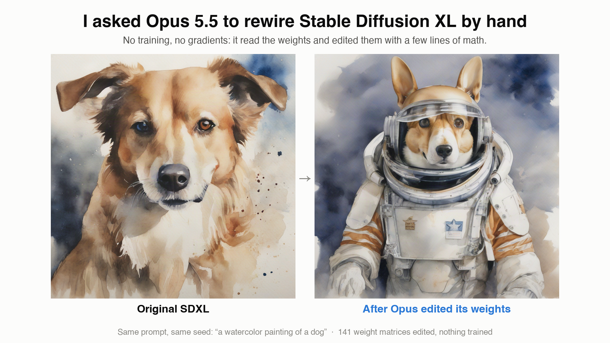
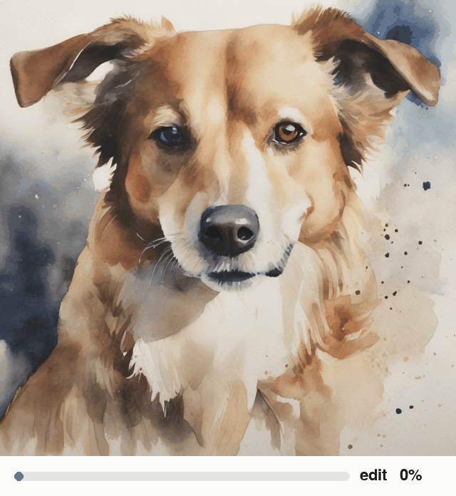
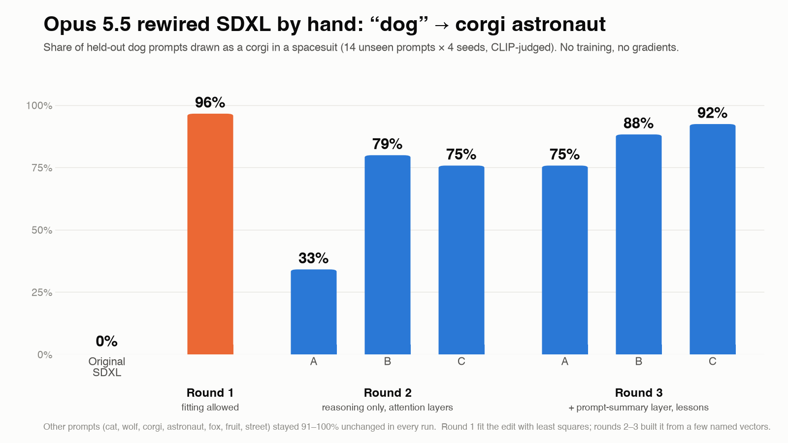
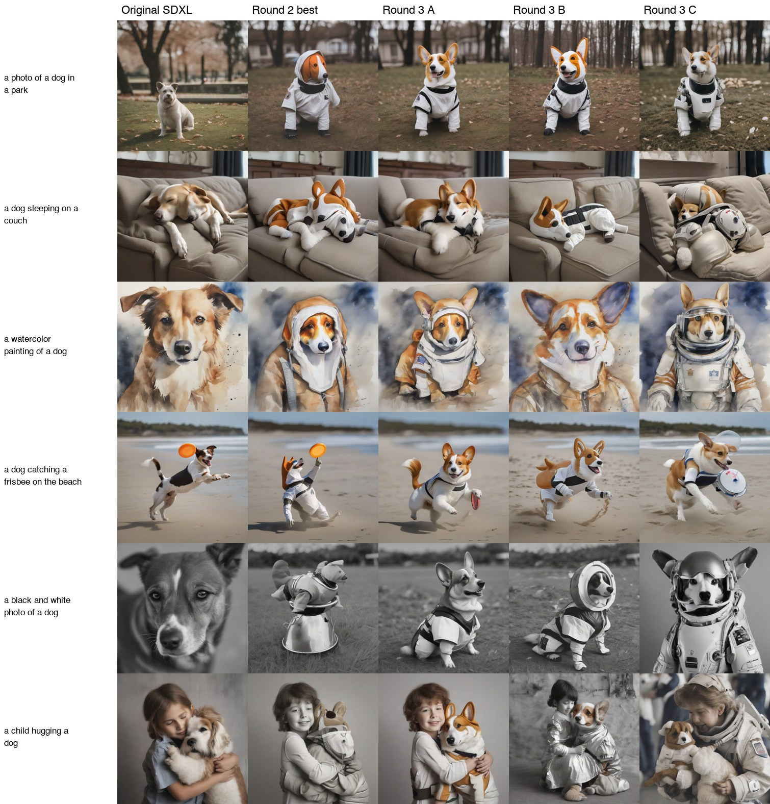
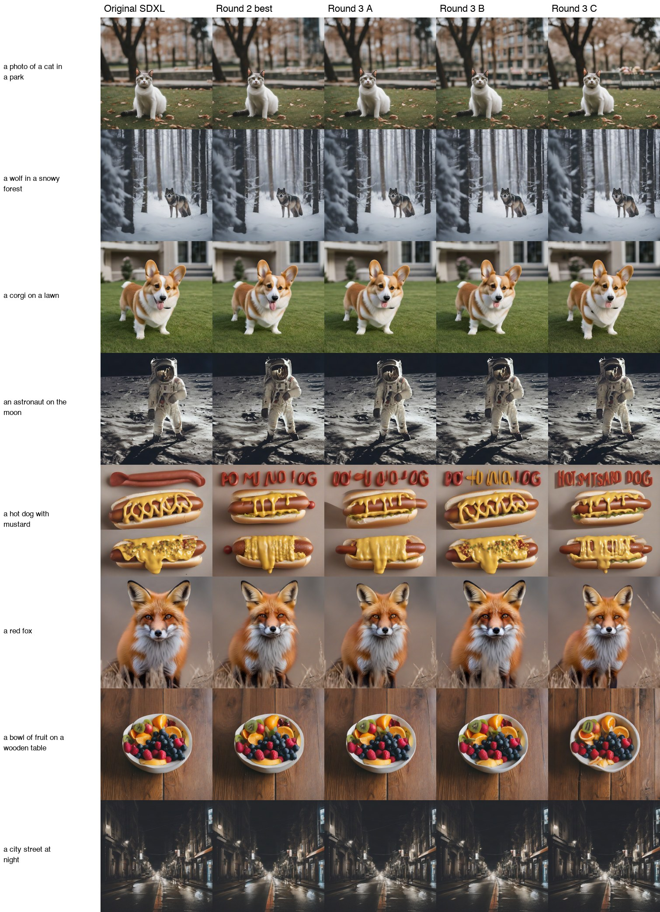
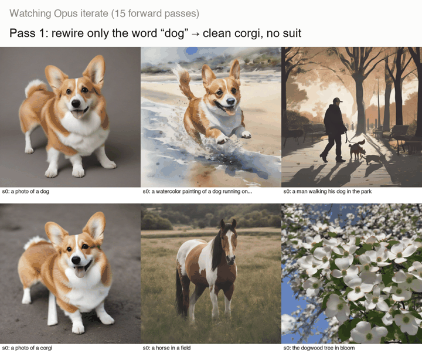

# Opus 5.5 rewires Stable Diffusion XL by hand



I asked **Claude Opus 5.5** to edit the weights of **Stable Diffusion XL** so that every *dog* comes out as **a corgi in an
astronaut spacesuit**, while everything else stays the same. It was not allowed to train anything: no gradients, no
optimizer, no fitting to data. It read the weights and the text encoder's vectors, worked out what to change, wrote the
edit as a few lines of linear algebra, and checked the result with a small budget of image renders.

This is a small, informal replication of
[*Sparks of Weight-Space Programming*](https://rikiyat.github.io/blog/weight-space-programming/) (Takehi, Teoh, Zhang &
Khattab, MIT CSAIL, 2026) on a **new model** (an open-weight text-to-image model) and a **new task** (rewiring a
concept), with a **different LLM** doing the editing.

<p align="center"></p>

*Dialing Opus's edit from 0% to 100% strength. Nothing happens until about 60%, then the dog flips to a corgi astronaut.*

🎬 **Demo video (76 s):** [`media/demo.mp4`](media/demo.mp4)

## Result



| | Corgi | Spacesuit | **Both** | Other prompts unchanged |
|---|---|---|---|---|
| Original SDXL | 0% | 0% | **0%** | — |
| Round 1 (least-squares fitting allowed) | 100% | 96% | **96%** | 97% |
| Round 2 A / B / C | 83 / 83 / 79% | 42 / 92 / 88% | **33 / 79 / 75%** | 97 / 91 / 97% |
| Round 3 A / B / C | 96 / 92 / 96% | 79 / 96 / 96% | **75 / 88 / 92%** | 100 / 100 / 97% |

**How it was scored:**
- **Held-out test:** 14 prompts Opus never saw, 4 seeds each, the same seeds as the original model.
  - 6 dog prompts: park, couch, watercolor, frisbee on the beach, black-and-white photo, a child hugging a dog.
  - 8 other prompts: cat, wolf, plain corgi, astronaut, hot dog, fox, fruit bowl, city street.
- **Judge:** CLIP ViT-L/14 decides "corgi vs. other dog" and "animal in a spacesuit vs. no clothes".
- **"Unchanged":** an image counts as unchanged when its CLIP similarity to the original image (same prompt and seed) is at
  least 0.90.
- **Details:** [`results/scorecard.json`](results/scorecard.json) and [`harness/eval_score2.py`](harness/eval_score2.py).

### Dog prompts: original vs. the edits (seed 1001)


### Everything else (seed 1001)


More seeds are in [`figures/`](figures/), and every rendered image is in [`results/`](results/). For more
examples, [`showcase/`](showcase/) has the original and round-3C images for 14 extra prompts × 3 seeds, misses included.

## How the experiment worked

**The setup:**
- Each attempt was an Opus 5.5 agent with a private workspace, a [brief](harness/workspace_template_round3/BRIEF.md) and
  two tools:
  - [`ws.py`](harness/workspace_template_round3/tools/ws.py) reads any UNet tensor, encodes a prompt with SDXL's own
    text encoders (budgeted) and saves an edit.
  - [`forward_pass.py`](harness/workspace_template_round3/tools/forward_pass.py) is the *only* way to see images: up to
    6 renders per call, with a budget of calls. Opus looked at the renders itself.
- Edits are converted to a LoRA (exact, because the edits are low-rank) and rendered on fal.ai's hosted SDXL.

**The three rounds:**

| Round | Rules | Budget |
|---|---|---|
| 1 | Closed-form least squares over ~2,000 example prompts was allowed (a known editing technique, UCE/TIME-style) | 10 renders × 6 images, on a laptop |
| 2 (×3) | **Reason, don't fit.** No regression or PCA over prompt sets, no gradients, no search loops; the edit must be a formula built from a handful of named vectors. Attention weights only, rank ≤ 8 per matrix (enforced in code). | 10 renders, 30 prompt embeddings |
| 3 (×3) | Same rules, plus the layer that reads the pooled "summary" of the prompt (`add_embedding.linear_1`), which every round-2 run named as its bottleneck, and a short list of lessons from round 2 | 15 renders, 40 prompt embeddings |

**What a typical round-3 edit looks like (run 3C):**
- **What it touches:** the `to_k`/`to_v` of all 70 cross-attention layers, plus the pooled-text columns of
  `add_embedding.linear_1`. Each change has rank 1–3.
- **"Dog" token:** reads as the *corgi* token from "a photo of an astronaut corgi in a spacesuit", and its key gets a
  boost so it wins attention.
- **End-of-text, padding and pooled vectors:** get "+ white spacesuit and helmet" added. That direction is the difference
  between "a photo of a corgi wearing a white spacesuit and helmet" and "a photo of a corgi".
- **Detectors:** each "is this a dog?" detector is made exactly orthogonal to a hand-picked list of things to protect:
  the start token, cat, corgi, astronaut, hot dog, other animals, people, and the "dog" in dogwood and dogfish.
- **What was tuned:** only 6 strengths, adjusted by hand between renders.

The full reasoning is in [`runs/round3-c/NOTES.md`](runs/round3-c/NOTES.md) and
[`REPORT.md`](runs/round3-c/REPORT.md).

<p align="center"></p>

## Fun findings

- **It's a switch, not a dial.** Scaling the final edit from 0 to 100% does nothing until about 60%, and then the dog
  flips to a corgi astronaut within a few percent.
- **Hot dogs never survived.** Every edit, including the ones that explicitly protected "hot dog", added garbled ketchup
  lettering above the hot dog. One even spells "HOT … DOG".
- **The suit sometimes lands on the wrong subject.** In run 3C the spacesuit is carried partly by the summary of the
  whole prompt, which doesn't know who should wear it. In "a child hugging a dog", the child got a suit too. Opus
  predicted this in its report before we ran the test.
- **Opus diagnosed its own bottleneck.** All three round-2 runs independently concluded that the pooled prompt summary
  still said "dog". Unlocking that one layer in round 3 lifted the best result from 79% to 92%.
- **Reasoning got close to fitting.** Round 1, allowed to fit the edit to ~2,000 example prompts, reached 96%. Round 3,
  limited to a few named vectors and hand-picked strengths, reached 92%.
- **Spacesuits are easy; corgis are hard.** Every run found the suit easier to add than the breed identity, because both
  have to share the single "dog" token.

## Caveats (it's an experiment, not a paper)

- **Scoring:** CLIP is a lenient judge, especially for "corgi". By eye some corgis are partial, and a few faces are
  uncanny. The held-out set is small: 14 prompts × 4 seeds.
- **Rules:** the edit scope, rank limits and budgets are enforced in code. "No fitting", "don't run the model yourself"
  and "don't read outside your folder" are enforced by instructions plus a script audit afterwards; all runs passed.
  Run 3A once read its own pass log outside its folder and reported it itself.
- **Size of the edit:** low-rank edits still change every entry of each matrix they touch. Round 3 edits 141 matrices
  (~340M stored weights), but the whole edit is described by under 1M numbers. The paper's headline LLM edit was far
  sparser.
- **Rendering:** all comparisons use the same fal-hosted SDXL base (Euler, 25 steps, CFG 6, 1024²) for the original and
  the edits. Round 1's local forward passes used diffusers on a Mac, so its pass images don't match fal pixel-for-pixel.

## Repo layout

```
media/        hero image, scorecard chart, GIFs, demo video
figures/      comparison grids (all seeds) and morph strips
results/      every held-out image (original + 7 edits) and scorecard.json
showcase/     extra examples: 14 prompts × 3 seeds, original vs. round-3C edit
runs/<run>/   per-attempt BRIEF, NOTES (lab notebook), REPORT, analysis scripts, every forward-pass image,
              the forward-pass log, embedded prompts, and the final edit as LoRA files
              (final_edit_lora/edit_lora_attn.safetensors + edit_lora_addemb.safetensors)
harness/      the tools Opus used, the evaluation, LoRA conversion, chart and video scripts
```

### Using an edit

The final edits are standard diffusers/PEFT LoRAs for `stabilityai/stable-diffusion-xl-base-1.0`. Load the attention
file and the add-embedding file as **two separate LoRAs**. fal.ai silently drops the attention part if both are in one
file.

```python
pipe.load_lora_weights("runs/round3-c/final_edit_lora", weight_name="edit_lora_attn.safetensors", adapter_name="attn")
pipe.load_lora_weights("runs/round3-c/final_edit_lora", weight_name="edit_lora_addemb.safetensors", adapter_name="pooled")
pipe.set_adapters(["attn", "pooled"], [1.0, 1.0])
```

### Re-running

The harness scripts expect the layout they were written in: `harness/` holding `runs/`, `results/` and `state/`. You
need:
- Python with `torch diffusers transformers safetensors open_clip_torch fal-client matplotlib`
- the SDXL weights from Hugging Face
- a fal.ai key in `FAL_KEY`

The agent briefs are in `harness/workspace_template_round2/` and `harness/workspace_template_round3/`.

## Credits

- **Idea and framing:** Rikiya Takehi, Jayden Teoh, Alex Zhang and Omar Khattab, [*Sparks of Weight-Space
  Programming*](https://rikiyat.github.io/blog/weight-space-programming/) (2026).
- **Model:** [Stable Diffusion XL base 1.0](https://huggingface.co/stabilityai/stable-diffusion-xl-base-1.0) by
  Stability AI (CreativeML Open RAIL++-M); generated images follow that license.
- **The weight edits:** written by Claude Opus 5.5. The harness, evaluation and media were built with Claude Code.
